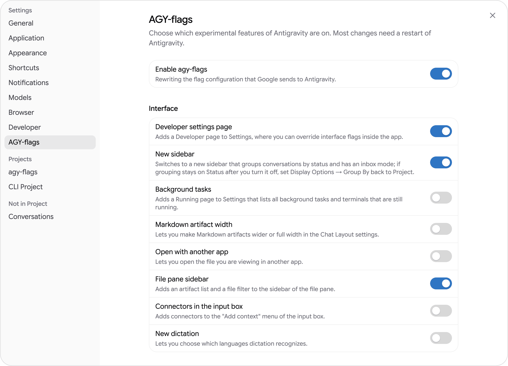
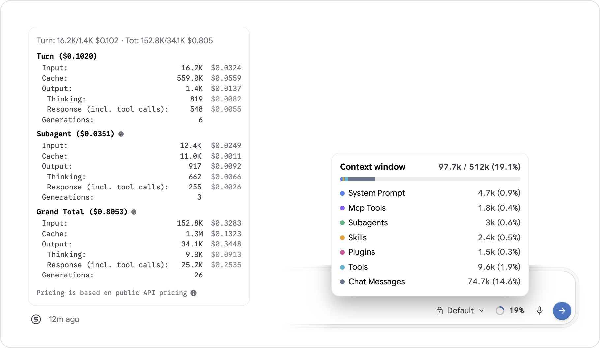

# agy-flags

Manage hidden experimental features of the Antigravity desktop app directly from its native Settings panel — plus a **Context Usage Indicator**, **Estimated Turn Costs**, a **Chinese UI**, and **Chinese Conversation Titles**.

[中文](README.md)



Many features in Antigravity are gated by server-side experiment flags sent by Google. `agy-flags` runs locally on your Mac, overrides those flag responses on the fly according to your preferences, and injects an **AGY-flags** management page straight into Antigravity's own Settings window.

- **No app bundle modification**: Uses native environment variables supported by Antigravity's language server. Nothing breaks or needs re-patching when the app auto-updates.
- **No root certificates or HTTPS MITM**: Connects cleanly through local endpoint overrides without intercepting system-wide HTTPS traffic.
- **Runs locally with zero dependencies**: Stays entirely on `127.0.0.1`. Only the optional "Estimated costs" feature makes a periodic request to download the public price list from `models.dev`.
- **Leaves the `agy` CLI untouched**: Identifies traffic by `User-Agent` so only desktop app requests are rewritten while CLI requests pass through unchanged.

macOS only (tested on Antigravity 2.35.0 – 2.35.2).

> [!NOTE]
> Experimental features are unreleased and may be unstable or stop working after client updates. Overriding server-supplied configuration may not comply with Google's Terms of Service — use at your own risk. This project is not affiliated with Google.

---

## What It Unlocks

### 1. Four Built-in Enhancements

Beyond toggling hidden flags, `agy-flags` ships four enhancements that flags alone cannot provide:



| Feature | Description |
| --- | --- |
| **Context usage indicator** | Public builds have the flag (`enable-context-usage-indicator`) but omit the UI component. `agy-flags` supplies the component, showing a live usage ring next to the input box with a breakdown popover by token category. |
| **Estimated costs** | Public builds lack a rate card, so "Token usage per reply" always shows `$0.0000`. Once enabled, `agy-flags` fetches public Vertex AI list prices from `models.dev` (at most once a day) and calculates estimated costs for each turn and subagent. |
| **Chinese interface** | Translates buttons, menus, and settings pages into Simplified Chinese without touching chat messages, code blocks, terminal output, or file/model names. |
| **Chinese conversation titles** | Antigravity prompts a small model for `"3 to 5 English words"` when naming a new chat. `agy-flags` rewrites that single instruction sentence in transit so new conversations get Simplified Chinese titles (no restart needed). |

### 2. Curated Experiment Flags

The settings page lists curated flags that have been tested or verified in the client code:

| Section | Feature | What it does |
| --- | --- | --- |
| **Interface** | Developer settings page | Adds a `Developer` page to Settings for overriding client-side UI flags |
| | New sidebar | Switches to the redesigned sidebar with status grouping and Inbox mode |
| | Background tasks | Adds a `Running` page to Settings listing active background tasks and terminals |
| | Markdown artifact width | Adds a `Chat Layout` option to make Markdown artifacts wider or full-width |
| | File pane sidebar | Adds an artifact list and file filter to the file viewer sidebar |
| | Open with another app | Lets you open the currently viewed file in an external macOS application |
| | Connectors in the input box | Adds a connectors entry to the `Add context` menu in the composer |
| | New dictation | Lets you restrict voice dictation to selected languages |
| **Conversations** | Conversation forking | Lets you branch a new conversation from any historical step |
| | Conversation groups | Lets you organize conversations into custom user-created groups |
| | Keep unsent drafts | Preserves unsent text in the input box across app restarts |
| | Telemetry switch per conversation | Adds a per-conversation toggle to disable telemetry |
| **Agents** | Code review (`/review-agent`) | Type `/review-agent` to have a read-only subagent review your diff and report issues |
| | Deep work (`/deepagent`) | Type `/deepagent` to launch a thorough, self-verifying subagent for complex tasks (uses more quota) |
| | Any model for subagents | Allows subagents to use any model from the model dropdown when specified in your prompt |
| | Teamwork subagents not forced to Flash | Prevents `/teamwork` subagents from being forced onto Flash so they can match the main model (marked untested) |
| | GitHub permissions per project | Lets you configure a GitHub token and scope allowed GitHub actions per project |
| | Encourage interactive widgets | Prompts the agent to render interactive HTML widgets inline when a visual helps |
| **Usage and costs** | Token usage per reply | Adds a `$` button below each reply showing input, cache read, and output tokens |
| **Plugin marketplace** | Plugin ranking and categories | Adds category filters and popularity sorting to the plugin marketplace |
| | Plugin user counts | Shows active user counts on marketplace plugin cards |
| **Computer use** | Computer use | Lets the agent delegate macOS app control to a subagent (restart twice after enabling, then grant Accessibility & Screen Recording permissions) |
| | Computer use: take over the screen | Allows the computer-use subagent to control mouse, keyboard, and full screen after confirmation (touching the Mac stops it immediately) |

> Need a flag that isn't in the curated list? You can add arbitrary boolean flags under `"flags"` in `config.json` (e.g. `"some-flag": true`).

---

## Installation

### One-Step Install (Recommended)

Open **Terminal** and run:

```bash
curl -fsSL https://raw.githubusercontent.com/prefusify/agy-flags/main/install.sh | bash
```

Once finished, **quit and reopen Antigravity**, open **Settings**, and select **AGY-flags** at the bottom of the left sidebar.

- **Self-contained runtime**: If your Mac doesn't have Node.js 18+, the script automatically downloads the official Node.js 24.22.3 binary from `nodejs.org`, verifies its SHA-256 checksum, and stores it inside `agy-flags`'s own folder. Nothing is installed system-wide and `sudo` is never used (requires macOS 13.5+).
- **Updating**: Re-run the install command above. It restarts the background daemon (any reply currently streaming will be interrupted).
- **Proxy users**: If you use a proxy tool to reach Google, enable its **TUN / Enhanced mode**. The local forwarder connects directly and does not read macOS System Proxy settings.

Check status or uninstall:

```bash
# Check daemon and flag status
curl -fsSL https://raw.githubusercontent.com/prefusify/agy-flags/main/install.sh | bash -s -- status

# Uninstall (keeps your config.json)
curl -fsSL https://raw.githubusercontent.com/prefusify/agy-flags/main/install.sh | bash -s -- uninstall

# Uninstall and delete all settings & logs
curl -fsSL https://raw.githubusercontent.com/prefusify/agy-flags/main/install.sh | bash -s -- uninstall --purge
```

### Install from Source

Requires Node.js 18 or later:

```bash
git clone https://github.com/prefusify/agy-flags.git
cd agy-flags
node bin/agy-flags.mjs install
```

`install` copies the app to `~/Library/Application Support/agy-flags/app`, loads the `dev.agy-flags.daemon` LaunchAgent, and sets the session environment variables. Re-run `install` after editing source files. You can also run `npm link` in the repo to use the `agy-flags` CLI globally:

| Command | Description |
| --- | --- |
| `agy-flags status` | Displays daemon health, environment variables, client routing state, and active flag overrides |
| `agy-flags uninstall [--restart-client] [--purge]` | Uninstalls `agy-flags`; optionally restarts Antigravity and deletes config/logs |
| `agy-flags daemon` | Runs the daemon in the foreground |

---

## Usage

1. In Antigravity, open **Settings** and click **AGY-flags** at the bottom of the left sidebar.
2. Toggle on the features you want (features with a risk badge will ask for confirmation first).
3. Click **Restart Antigravity** in the top banner. Except for "Chinese conversation titles", Antigravity reads flags only at startup.
4. **Enable agy-flags** at the top is the master switch: turning it off and restarting makes Antigravity connect directly to Google without rewriting anything, while keeping the `AGY-flags` settings page available so you can turn it back on anytime.

> [!TIP]
> After turning on **Context usage indicator** and restarting, also enable `Settings → Appearance → Advanced Settings → Chat Layout → Context and quota indicator` (off by default in the client).

---

## How It Works & Security

### 1. Flag Rewriting & Request Forwarding (Ports 47931 / 47932)

Antigravity's language server fetches experiment flags from `daily-cloudcode-pa.googleapis.com` (`listExperiments`) and `aicode.googleapis.com` (`fetchConfig`). It natively honors two environment variables — `CLOUD_CODE_URL` and `AICODE_ENDPOINT_URL` — to override those endpoints:

```text
Antigravity ──HTTP──▶ agy-flags (127.0.0.1:47931 / 47932) ──HTTPS──▶ Google
```

- Once its local ports are listening, the daemon sets those variables in your macOS login session via `launchctl setenv`.
- In `listExperiments` and `fetchConfig` responses, only your selected boolean flags are overridden; all other fields stay untouched. If rewriting ever fails, the original response passes through unchanged.
- Every other request (including chat streams) is piped straight through without buffering or logging.

### 2. Settings Page & UI Script Injection (Port 47933)

The **AGY-flags** settings page, **Context usage indicator**, **Estimated costs**, and **Chinese interface** all patch the client's frontend bundle (`main.js`). Rather than modifying `/Applications/Antigravity.app`, `agy-flags` uses a third native environment variable, `AGY_DEV_UI_URL`:

- The daemon serves the client's UI assets on `127.0.0.1:47933`, reading them directly from the installed language server binary and appending `agy-flags`'s components to `main.js` in memory.
- Each patch locates its target by AST/code shape rather than minified variable names. If a client update changes one shape, only that patch is skipped (with a warning in Settings) while everything else keeps working.

### 3. Local Security & Privacy

Because your auth tokens and conversation traffic pass through the local forwarder:

- **Loopback only**: All ports bind strictly to `127.0.0.1`. Upstream connections always use HTTPS with standard certificate verification. Logs record lifecycle events only — never headers or bodies.
- **Same-user & same-origin protection**: The settings API on port 47933 uses `lsof` to verify that the connecting process (and any process connected to the language server) belongs to your macOS UID, blocking other local users on a shared Mac. It also enforces `Host` checks, requires `Sec-Fetch-Site: same-origin`, and rejects requests with an `Origin` header so websites in your browser cannot read or change your settings.

---

## Troubleshooting & FAQ

<details>
<summary><b>1. The "AGY-flags" page is missing from Settings</b></summary>

1. **Quit and reopen Antigravity first.** Only an instance started while the `agy-flags` daemon is running inherits the environment variables (an app window auto-restored at macOS login may have started before the daemon).
2. Still missing? Run `agy-flags status`:
   - `pending`: One more client restart is required.
   - `warning: page-not-changed`: A client update changed the shape of `main.js` so the UI page couldn't be injected. You can still configure everything by editing `~/Library/Application Support/agy-flags/config.json` (auto-reloaded on save, then restart Antigravity):
     - `enabled`: Master switch (`true` / `false`)
     - `flags`: Flag overrides (e.g. `{"enable-developer-mode": true}`)
     - `features`: Built-in enhancements (`costPrices`, `uiChinese`, `chineseTitles`)
     - `pageLanguage`: Language of the AGY-flags page (`auto` follows the system, `zh`, `en`); also switchable at the top right of that page
</details>

<details>
<summary><b>2. Reloading the Antigravity window shows <code>The dev UI server at … is not reachable</code></b></summary>

While `AGY_DEV_UI_URL` is set, Antigravity loads its frontend assets from `agy-flags` on port 47933. If the daemon is stopped, a reloaded window cannot fetch its UI.
- Restart the daemon, or uninstall `agy-flags` to return to normal.
- To bypass `agy-flags` immediately without uninstalling, clear the variables and restart Antigravity:
  ```bash
  launchctl unsetenv CLOUD_CODE_URL AICODE_ENDPOINT_URL AGY_DEV_UI_URL
  ```
</details>

<details>
<summary><b>3. After stopping or uninstalling, the <code>agy</code> CLI says <code>plan model not specified</code></b></summary>

Because session variables are inherited by Terminal windows, the `agy` CLI also routes through `agy-flags` while it runs (and is passed through unchanged via its `User-Agent: antigravity/cli/…`).
After you stop or uninstall `agy-flags`, **already-open Terminal windows** still hold the old environment variables. Quit and reopen Terminal completely, or run:

```bash
unset CLOUD_CODE_URL AICODE_ENDPOINT_URL AGY_DEV_UI_URL
```
</details>

<details>
<summary><b>4. What happened to "Prompt cache keep-alive"?</b></summary>

It was removed because it frequently stopped after one or two pings, and any ping that missed the cache was billed as full uncached input. If you enabled it in an earlier version, manually remove `enable-prompt-cache-keep-alive` and `prompt_cache_keep_alive_max_pings` from `"flags"` in `~/Library/Application Support/agy-flags/config.json`.
</details>

---

## Files & Development

All runtime data lives in `~/Library/Application Support/agy-flags/`:

| Path | Purpose |
| --- | --- |
| `config.json` | Your flag overrides, feature toggles, ports, and upstream URLs (editable by hand; auto-reloads) |
| `state.json` | Last seen server flag snapshot and model display names |
| `prices.json` | Cached price list from `models.dev` |
| `daemon.log` | Daemon event log |
| `app/` & `runtime/` | Installed program copy and standalone Node.js runtime |

The LaunchAgent plist is `~/Library/LaunchAgents/dev.agy-flags.daemon.plist`.

### Running Tests

```bash
npm test
```

The test suite runs completely isolated in memory and temporary folders — it never calls `launchctl`, touches your real settings directory, or makes network requests.

- **Forwarding & rewriting**: [`src/forward.mjs`](src/forward.mjs) (HTTP proxy & title prompt rewrite), [`src/patch.mjs`](src/patch.mjs) (flag response patching), [`src/daemon.mjs`](src/daemon.mjs) (daemon lifecycle)
- **UI injection & Settings page**: [`src/bundle.mjs`](src/bundle.mjs) (reads embedded UI assets from the language server binary), [`src/uipatch.mjs`](src/uipatch.mjs) (context indicator & cost repricer), [`src/settingspage.mjs`](src/settingspage.mjs) (`AGY-flags` settings page), [`src/uiserver.mjs`](src/uiserver.mjs) (asset server & settings API)
- **Localization & catalog**: [`src/l10n.mjs`](src/l10n.mjs) & [`src/l10n/zh-CN.json`](src/l10n/zh-CN.json) (Chinese translator & string table), [`src/catalog.json`](src/catalog.json) (curated feature catalog), [`tools/l10n-candidates.mjs`](tools/l10n-candidates.mjs) (scans updated client bundles for untranslated strings)

## License & Credits

[MIT](LICENSE).

- Portions of the Chinese localization table are adapted from [antigravity-chinese](https://github.com/yiheng8023/antigravity-chinese) (MIT; see [`src/l10n/LICENSE-antigravity-chinese.txt`](src/l10n/LICENSE-antigravity-chinese.txt)).
- The idea of embedding feature toggles directly into the host app's native Settings window was inspired by [obsidian-prism](https://github.com/RMvdesi/obsidian-prism) (no code was used).
