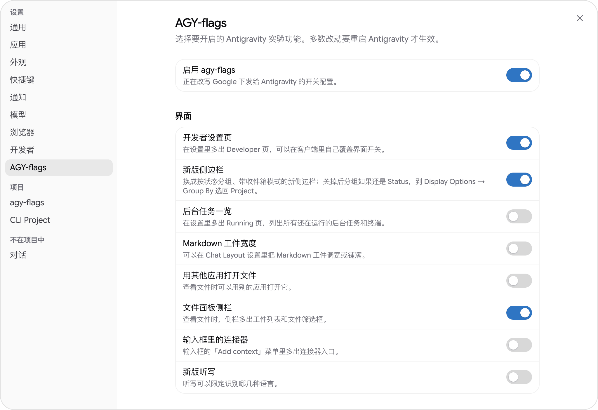
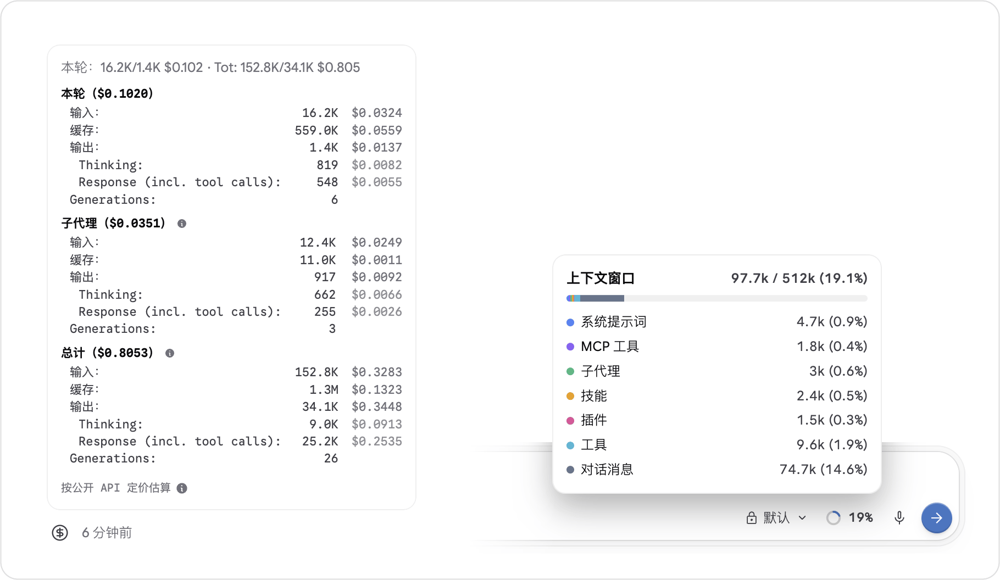

# agy-plus

**Antigravity 桌面端原生体验增强工具** —— 直接嵌入客户端「设置」面板，提供**界面汉化**、**中文对话标题**、**上下文用量指示器**、**单轮费用估算**，并支持一键开启对话分叉、代码审查等隐藏功能。

[English](README.en.md)



Antigravity 桌面版缺少中文界面、上下文余量提示与费用明细，同时许多实用能力受服务端实验开关（Experiment Flags）控制默认隐藏。`agy-plus` 在本机后台静默运行，将补齐的界面组件与功能开关集中放进 Antigravity 原生设置窗口的 **AGY Plus** 页面中，开箱即用。

- **不修改客户端安装包**：通过语言服务器原生支持的环境变量加载增强界面与转发配置，不破坏应用签名，客户端自动更新后无需重新打补丁。
- **免安装根证书**：不做系统级 HTTPS 中间人劫持（MITM），仅接管客户端显式允许覆盖的本地端点变量。
- **纯本地运行、零第三方依赖**：仅绑定 `127.0.0.1`。除可选的「估算费用」功能会定期拉取 `models.dev` 的公开模型价格表外，不向任何外部服务发送请求。
- **不影响命令行 `agy`**：通过 `User-Agent` 区分请求来源，仅增强桌面端请求，命令行 `agy` 的流量原样透传。

支持 macOS（已在 Antigravity 2.35.0 ～ 2.35.2 上实测）。

> [!NOTE]
> 实验性功能尚未由官方正式发布，可能存在不稳定或随客户端更新失效的情况。改写服务端下发配置可能不符合 Google 服务条款，请自行评估风险使用。本项目与 Google 无关。

---

## 功能一览

### 1. 四项核心体验增强

`agy-plus` 补齐了四项客户端对外发布版缺失或仅靠实验开关无法实现的日常刚需功能：



| 功能 | 说明 |
| --- | --- |
| **界面汉化** | 将按钮、菜单、右键菜单、系统通知与设置页翻译为简体中文。不会翻译对话正文、代码块、终端输出、输入框以及文件名和模型名。 |
| **中文对话标题** | 客户端默认要求模型用「3 到 5 个英文单词」生成标题。开启后会在请求转发时将该句提示词替换为简体中文，新对话自动使用中文标题（无需重启）。 |
| **上下文用量指示器** | 补全对外发布版缺失的指示器组件，在输入框旁显示当前上下文占用圆环，点击可查看系统提示词、工具、消息等分类 Token 占用明细。 |
| **估算费用** | 对外发布版因缺少价格表，单轮回复用量里的金额恒为 `$0.0000`。开启后会按 `models.dev` 的公开列表价自动算出主对话与各子代理的估算开销（仅供参考，非实际账单）。 |

### 2. 精选隐藏实验开关

除了内置增强，设置页还按类别整理了经过实测或代码核对的精选隐藏功能：

| 类别 | 功能名称 | 作用说明 |
| --- | --- | --- |
| **界面** | 开发者设置页 | 在设置中显示 `Developer` 页，可在客户端内直接覆盖部分前端开关 |
| | 新版侧边栏 | 切换为按状态分组、带收件箱（Inbox）模式的新版侧边栏 |
| | 后台任务一览 | 在设置中显示 `Running` 页，集中查看正在运行的后台任务与终端 |
| | Markdown 工件宽度 | 在 `Chat Layout` 设置中允许将 Markdown 工件调宽或铺满窗口 |
| | 文件面板侧栏 | 查看文件时，在侧栏增加工件列表与文件筛选框 |
| | 用其他应用打开文件 | 查看文件时支持调用系统中的其他应用打开当前文件 |
| | 输入框里的连接器 | 在输入框的 `Add context` 菜单中显示连接器入口 |
| | 新版听写 | 支持为语音听写限定识别语言 |
| **对话** | 对话分叉 | 支持从历史对话的任意一步分叉（Fork）出一条新对话 |
| | 对话分组 | 支持创建自定义分组来归类管理对话 |
| | 保留未发送的草稿 | 输入框中未发送的草稿在客户端重启后依然保留 |
| | 单个对话的遥测开关 | 允许为单条对话单独关闭遥测上报 |
| **代理** | 代码审查 (`/review-agent`) | 输入 `/review-agent` 召唤子代理以只读方式审查当前代码改动并指出问题 |
| | 深度工作 (`/deepagent`) | 输入 `/deepagent` 让子代理对复杂问题进行多轮深入排查与反复验证（消耗更多配额） |
| | 子代理可用任意模型 | 允许在消息中指定子代理使用模型菜单里的任意模型 |
| | Teamwork 子代理不强制用 Flash | 让 `/teamwork` 启动的子代理跟随主对话模型，不再强制降级为 Flash（标记为未实测） |
| | 项目的 GitHub 权限 | 在项目设置中配置 GitHub 令牌，并限制代理允许执行的 GitHub 操作 |
| | 鼓励代理用交互小部件 | 提示代理在适合可视化展示时，直接在对话内生成可交互的 HTML 小部件 |
| **用量和费用** | 回复用量 | 在每条回复下方增加 `$` 按钮，点击查看本轮输入、缓存命中与输出 Token 数 |
| **插件市场** | 插件市场排序和分类 | 为插件市场增加分类筛选，并按热门程度排序 |
| | 插件使用人数 | 在插件卡片上显示当前使用人数 |
| **电脑操作** | 电脑操作 (Computer Use) | 允许代理派子代理操作当前 Mac 上的桌面应用（首次启用需重启两次并授予辅助功能与录屏权限） |
| | 电脑操作：接管屏幕 | 允许子代理在征得确认后接管鼠标、键盘与整个屏幕（工作期间触碰电脑即自动停止） |

> 精选列表之外的其他实验开关，也可以手动写入配置文件 `config.json` 的 `flags` 字段中（例如 `"some-flag": true`）。

---

## 安装与卸载

### 一键脚本（推荐）

打开「终端（Terminal）」，执行以下命令：

```bash
curl -fsSL https://raw.githubusercontent.com/prefusify/agy-plus/main/install.sh | bash
```

安装完成后，**退出并重新打开 Antigravity**，进入「设置（Settings）」，点击左侧底部的 **AGY Plus** 即可按需开启功能。

- **自带运行时**：如果系统中没有 Node.js 18+，安装脚本会自动从 `nodejs.org` 下载官方 Node.js 24.22.3（校验 SHA-256）并放入 `agy-plus` 自己的数据目录，不会污染系统环境，也不需要 `sudo` 密码（需 macOS 13.5+）。
- **更新版本**：再次运行上面的安装命令即可完成更新（更新时会重启后台常驻进程，正在生成的回复会中断）。
- **网络代理注意**：如果你需要代理才能访问 Google，请开启代理软件的 **TUN 模式（增强模式）**。本工具的本地转发直连网络，不读取 macOS「系统代理」设置。

查看运行状态或卸载：

```bash
# 查看运行状态
curl -fsSL https://raw.githubusercontent.com/prefusify/agy-plus/main/install.sh | bash -s -- status

# 卸载（保留配置文件）
curl -fsSL https://raw.githubusercontent.com/prefusify/agy-plus/main/install.sh | bash -s -- uninstall

# 彻底卸载（同时删除配置与日志）
curl -fsSL https://raw.githubusercontent.com/prefusify/agy-plus/main/install.sh | bash -s -- uninstall --purge
```

### 从源码安装

需要已安装 Node.js 18 或更高版本：

```bash
git clone https://github.com/prefusify/agy-plus.git
cd agy-plus
node bin/agy-plus.mjs install
```

`install` 会将程序复制到 `~/Library/Application Support/agy-plus/app`，注册 `launchd` 登录自启项 `dev.agy-plus.daemon` 并写入会话环境变量。修改源码后重新执行 `install` 即可生效。在仓库内执行 `npm link` 后可在任意位置直接使用 `agy-plus` 命令：

| 命令 | 作用 |
| --- | --- |
| `agy-plus status` | 查看后台进程、环境变量、客户端连接及已修改开关的状态 |
| `agy-plus uninstall [--restart-client] [--purge]` | 卸载工具；可选顺带重启客户端或清除全部配置文件与日志 |
| `agy-plus daemon` | 在前台运行守护进程（用于调试） |

---

## 使用方法

1. 打开 Antigravity「设置」，点击左侧导航栏底部的 **AGY Plus**。
2. 勾选需要开启的功能（带有风险提示的功能会在点击时弹出确认框）。
3. 点击页面顶部的 **「重启 Antigravity」** 按钮。除「中文对话标题」立即生效外，其余改动均需客户端重启后生效。
4. 页面顶部的 **「启用 agy-plus」** 是总开关：关闭并重启后，客户端将直连 Google，不再改写任何响应，但设置里的 `AGY Plus` 页面仍会保留，方便随时重新开启。

> [!TIP]
> 开启 **「上下文用量指示器」** 并重启客户端后，还需要在客户端设置 `Settings → Appearance → Advanced Settings → Chat Layout` 中勾选 **「Context and quota indicator」**（客户端默认关闭该显示项）。

---

## 工作原理与安全性

### 1. 实验开关与请求转发（端口 47931 / 47932）

Antigravity 的语言服务器在启动时会向 `daily-cloudcode-pa.googleapis.com`（`listExperiments`）和 `aicode.googleapis.com`（`fetchConfig`）拉取实验开关，并原生支持通过环境变量 `CLOUD_CODE_URL` 和 `AICODE_ENDPOINT_URL` 覆盖这两个地址：

```text
Antigravity ──HTTP──▶ agy-plus (127.0.0.1:47931 / 47932) ──HTTPS──▶ Google
```

- 守护进程启动本地端口后，通过 `launchctl setenv` 将上述环境变量注入当前 macOS 登录会话。
- 转发层仅在收到 `listExperiments` 与 `fetchConfig` 响应时覆盖你选中的布尔开关，其余字段原样保留；若开启了「中文对话标题」，则仅识别起标题请求并替换语言指令句。
- 其他所有请求（包括日常对话流）均以流式原样透传，不落盘、不写日志。

### 2. 原生设置页与前端注入（端口 47933）

「AGY Plus 设置页」「上下文用量指示器」「估算费用」和「界面汉化」需要向客户端前端脚本 `main.js` 注入组件。为了不修改 `/Applications/Antigravity.app`（避免破坏签名及更新失效），本工具利用了语言服务器支持的第三个环境变量 `AGY_DEV_UI_URL`：

- 守护进程在 `127.0.0.1:47933` 提供前端静态资源：直接从本机已安装的语言服务器二进制中读取原始界面文件，仅在内存中向 `main.js` 追加所需组件。
- 客户端更新导致某处代码结构变化时，未匹配到的单点补丁会自动跳过并在设置页提示警告，不影响其他功能正常工作。

### 3. 本地安全与隐私设计

由于登录凭证与对话流量会经过本地转发进程，`agy-plus` 做了严格的本地隔离：

- **仅监听回环地址**：所有端口仅绑定 `127.0.0.1`，上游固定使用 HTTPS 并校验证书；日志仅记录启动与改写事件，绝不记录请求头或正文内容。
- **跨用户与网页防越权**：设置接口（47933 端口）会调用 `lsof` 校验发起连接进程的 UID，确保只有你本人账户下的进程才能读写配置；同时严格校验 `Host`、`Sec-Fetch-Site: same-origin` 并拒绝带 `Origin` 的跨站请求，防止浏览器网页探测或篡改。

---

## 常见问题（FAQ）

<details>
<summary><b>1. 设置里找不到「AGY Plus」这一页？</b></summary>

1. 请先**完全退出并重新打开一次 Antigravity**。只有在 `agy-plus` 启动之后打开的客户端才会读取到环境变量（开机自动恢复的窗口可能早于守护进程启动）。
2. 如果重启后仍不显示，请在终端运行 `agy-plus status` 查看原因：
   - 显示 `pending`：说明还需要重启一次客户端。
   - 显示 `warning: page-not-changed`：说明客户端更新后前端代码结构发生了变化，设置页暂时无法注入。此时可直接手动编辑 `~/Library/Application Support/agy-plus/config.json`（保存后自动热加载，改完重启客户端即可）：
     - `enabled`：总开关（`true` / `false`）
     - `flags`：实验开关字典（如 `{"enable-developer-mode": true}`）
     - `features`：内置增强功能（`costPrices`、`uiChinese`、`chineseTitles`）
     - `pageLanguage`：AGY Plus 页的语言（`auto` 跟随系统、`zh`、`en`），也可在该页右上角切换
</details>

<details>
<summary><b>2. 客户端窗口重新加载后白屏，显示 <code>The dev UI server at … is not reachable</code>？</b></summary>

这是因为设置了 `AGY_DEV_UI_URL` 后，客户端依赖 `agy-plus` 的 47933 端口提供界面文件。如果后台守护进程被手动停止，窗口刷新时就会找不到界面资源。
- 重新启动守护进程，或者运行卸载命令即可恢复。
- 如果需要临时绕过 `agy-plus`，可在终端执行以下命令后重启 Antigravity：
  ```bash
  launchctl unsetenv CLOUD_CODE_URL AICODE_ENDPOINT_URL AGY_DEV_UI_URL
  ```
</details>

<details>
<summary><b>3. 停止或卸载后，终端里运行命令行 <code>agy</code> 报错 <code>plan model not specified</code>？</b></summary>

因为环境变量设在 macOS 登录会话中，命令行 `agy` 也会继承并把请求发往本地端口（运行时 `agy-plus` 会根据 `User-Agent: antigravity/cli/…` 将其原样放行）。
当 `agy-plus` 停止或卸载后，**之前已经打开的终端窗口**里还残留着旧的环境变量。只需**完全退出终端重新打开**，或在当前终端执行：

```bash
unset CLOUD_CODE_URL AICODE_ENDPOINT_URL AGY_DEV_UI_URL
```
</details>

<details>
<summary><b>4. 以前开过「提示词缓存保活」怎么办？</b></summary>

该开关在新版本中已移除（实测经常只发一两次心跳就停止，且未命中缓存时反而按完整输入计费）。如果你在旧版本中开启过它，请打开 `~/Library/Application Support/agy-plus/config.json`，从 `flags` 中手动删掉 `enable-prompt-cache-keep-alive` 和 `prompt_cache_keep_alive_max_pings`。
</details>

---

## 文件路径与开发

所有运行时文件均存放在 `~/Library/Application Support/agy-plus/`：

| 路径 | 说明 |
| --- | --- |
| `config.json` | 已修改的开关、功能项、端口与上游地址（支持手动编辑并自动重载） |
| `state.json` | 最近一次观测到的服务端开关快照与模型显示名称 |
| `prices.json` | 从 `models.dev` 缓存的公开价格表 |
| `daemon.log` | 守护进程运行日志 |
| `app/` 与 `runtime/` | 安装时复制的程序代码与独立 Node.js 运行时 |

登录自启配置文件位于 `~/Library/LaunchAgents/dev.agy-plus.daemon.plist`。

### 本地开发与测试

```bash
npm test
```

测试套件完全在沙盒内存与临时目录中运行，不会调用 `launchctl`、不修改真实配置目录，也不访问外部网络。

- **核心转发与改写**：[`src/forward.mjs`](src/forward.mjs)（HTTP 转发与标题请求改写）、[`src/patch.mjs`](src/patch.mjs)（实验开关响应改写）、[`src/daemon.mjs`](src/daemon.mjs)（常驻进程）
- **界面注入与设置页**：[`src/bundle.mjs`](src/bundle.mjs)（提取内置前端资源）、[`src/uipatch.mjs`](src/uipatch.mjs)（指示器与费用重算注入）、[`src/settingspage.mjs`](src/settingspage.mjs)（AGY Plus 设置页）、[`src/uiserver.mjs`](src/uiserver.mjs)（静态资源与接口服务）
- **汉化与功能目录**：[`src/l10n.mjs`](src/l10n.mjs) & [`src/l10n/zh-CN.json`](src/l10n/zh-CN.json)（界面汉化与词条表）、[`src/catalog.json`](src/catalog.json)（精选功能清单，欢迎提交实测反馈）、[`tools/l10n-candidates.mjs`](tools/l10n-candidates.mjs)（扫描客户端新版本未翻译词条）

## 许可证与致谢

本项目基于 [MIT](LICENSE) 许可证开源。

- 界面汉化词条表部分整理自 [antigravity-chinese](https://github.com/yiheng8023/antigravity-chinese)（MIT，许可声明见 [`src/l10n/LICENSE-antigravity-chinese.txt`](src/l10n/LICENSE-antigravity-chinese.txt)）。
- 将功能开关直接嵌入客户端原生设置面板的交互思路启发自 [obsidian-prism](https://github.com/RMvdesi/obsidian-prism)（未使用其代码）。
